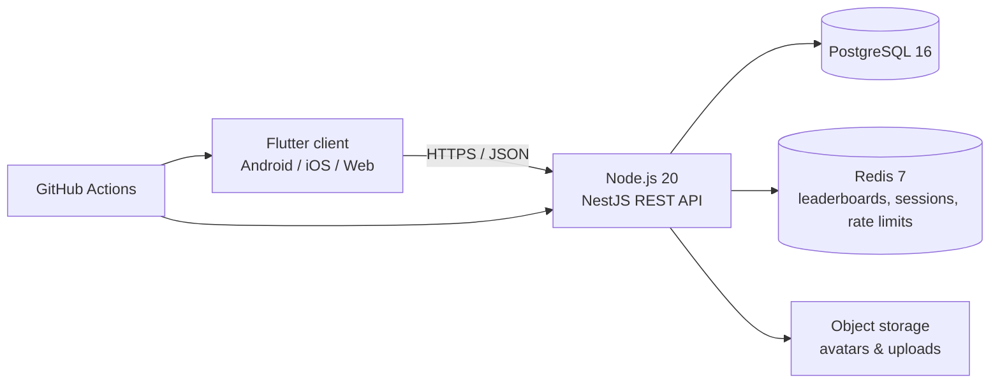

# CodeBro (Tango) — Project Plan

> **Single source of truth for product, frontend, backend, UI/UX and delivery.**
> Version 1.0 · Baseline `a5e7048` (`main`) · Last updated 2026-11-25

---

## 1. Vision & scope

**CodeBro** is a gamified, developer-first learning platform. Users learn programming through structured courses, interactive lessons with a built-in editor, quizzes, XP/levels, streaks, achievements and social competition. The Flutter client targets Android, iOS and Web; the Node backend is a separate deployable service in this repository.

**Product pillars**

| Pillar | What it means in the product |
|---|---|
| Learn by building | Every course has lessons with theory, code examples, challenges and a runnable playground |
| Gamification that is earned | XP ledger, levels, streak freezes, badges and leaderboards derived from real activity |
| Developer-native UI | Dark IDE-inspired design, glassmorphism, tokenized motion, code typography |
| Global by default | 6 locales (en, ar, fr, es, tr, ur), full RTL mirroring, exact locale-aware formatting |
| Production-grade engineering | Typed routes, testable state, documented API, CI, release flavors |

**Non-goals for v1:** native code execution sandbox, payment/subscriptions, AI chat (deferred to a Python microservice), push notifications provider integration beyond the notification inbox.

---

## 2. Current-state audit (baseline `a5e7048`)

The repository contains a large amount of work, but its documentation and its code disagree. The plan is built on the *actual* code, not the README.

| Area | Claimed in docs | Actual in code |
|---|---|---|
| State management | Riverpod | `setState` + 5 hand-rolled `ChangeNotifier` controllers; no state package in `pubspec.yaml` |
| Backend | REST + PostgreSQL + Redis | No networking package at all; `backend_api_services/` (~285 KB) is un-wired and imports undeclared `crypto` / `shared_preferences`, so it cannot compile |
| Persistence | Secure Storage + Hive | No persistence package; all content is hardcoded in widgets/controllers; nothing survives restart |
| Languages | 12 locales | 6 locales (`lib/core/localization/app_locale.dart:8-14`): en, ar, fr, es, tr, ur |
| Screens | All ✅ | `lib/main.dart:59-98` routes ~10 original pages; `*_v3`, `*_localized`, `lesson_interactive`, `social_leaderboard`, `ui_master`, motion libraries have no call site |
| Structure | Feature-first | 4 overlapping UI layers + duplicate models (three different `Lesson` classes) |
| Tests | Golden/widget/unit | ~36 co-located `flutter_test` files + 3 under `test/`; no golden tests, no CI, no backend tests |

**Strengths worth preserving:** the token system in `lib/core/theme/`, the hand-rolled i18n foundation with RTL support and exact-decimal formatting, the shared widget library in `lib/features/ui_components/widgets/`, and the existing test habits.

**Conclusion:** the highest-value work is *not* adding more screens. It is making one coherent product out of the existing pieces, adding a real backend, and telling the truth in the docs.

---

## 3. Target architecture

### 3.1 System



### 3.2 Frontend layers

```
lib/
├── main.dart                     # bootstrap only
├── app/
│   ├── app.dart                  # ProviderScope + MaterialApp.router
│   ├── router.dart               # go_router tree + auth guard
│   └── theme.dart                # ThemeData from core/theme tokens + fonts
├── core/
│   ├── theme/                    # colors, text, spacing, radius, shadows, gradients, motion
│   ├── localization/             # 6 catalogues, LocaleController, RTL widgets, formats
│   ├── network/                  # Dio client, interceptors, API exceptions
│   ├── state/                    # session/theme/locale providers
│   ├── constants/  extensions/   # shared constants and BuildContext helpers
│   └── ui/                       # canonical design-system widgets
└── features/<area>/
    ├── domain/                   # entities + repository interfaces
    ├── data/                     # DTOs + repository implementations
    └── presentation/
        ├── pages/                # routed screens
        └── widgets/              # feature-private widgets
```

**Rules**
- A feature never imports another feature's `presentation/`; shared UI goes in `core/ui/`.
- All I/O goes through repositories; pages consume Riverpod providers, never `HttpClient` directly.
- Every user-facing string goes through `StringKeys` + catalogues; every layout is RTL-safe.
- One canonical screen per product area. Duplicate UI layers are archived (see §5, phase 1).

### 3.3 Backend layers

```
backend/
├── prisma/                       # schema.prisma, migrations/, seed.ts
├── src/
│   ├── common/                   # guards, filters, decorators, xp.ts, pagination
│   ├── config/                   # typed env configuration
│   ├── prisma/                   # PrismaService
│   ├── redis/                    # RedisService
│   └── modules/
│       ├── auth  users  courses  progress  quizzes  xp
│       ├── streaks  achievements  leaderboard  social  notifications  health
├── test/                         # supertest e2e (mocked Prisma)
└── README.md
```

**Rules**
- Controllers validate DTOs; services own business logic; Prisma is only used in services.
- Every mutating XP/progress operation is transactional and writes an `XPTransaction` ledger row.
- Leaderboard ranks live in Redis sorted sets and are rebuilt from Postgres on cache miss.
- API prefix `/api/v1`; lists return `{ data, meta: { nextCursor, hasMore } }`; errors return `{ error: { code, message, details? } }`.

---

## 4. Tech stack

| Layer | Choice | Why |
|---|---|---|
| Client | Flutter 3.44 / Dart 3.12, Material 3 | Single codebase for Android, iOS, Web |
| State | Riverpod | Compile-safe, testable, replaces 5 ad-hoc notifiers |
| Routing | go_router | Typed deep links, auth redirect, route guards |
| HTTP | Dio + Retrofit-style repositories | Interceptors for token refresh, retries, error mapping |
| Serialization | Freezed + json_serializable | Immutable entities and generated `fromJson`/`toJson` |
| Local data | SharedPreferences + FlutterSecureStorage | Tokens secure, preferences plain |
| Backend | Node.js 20, TypeScript strict, NestJS 10 | Static typing close to Dart, modular architecture, WebSocket-ready |
| Database | PostgreSQL 16 + Prisma 5 | Relational integrity for progress/XP graphs, typed client |
| Cache | Redis 7 (ioredis) | Leaderboards, rate limits, short-lived session data |
| Auth | JWT access + rotating refresh token (bcrypt hash at rest) | Standard, revocable, mobile-friendly |
| API docs | Swagger/OpenAPI at `/api/docs` | Contract-first client integration |
| Quality | `flutter analyze`, `flutter test`, Jest, ESLint, GitHub Actions | Repeatable gates |
| Delivery | Docker Compose, Flutter flavors (dev/stg/prod) | Reproducible environments |

---

## 5. Roadmap & acceptance criteria

### Phase 0 — Documentation (this document + README)
- **Deliver:** this plan; rewritten `README.md` with accurate status legend, quickstart, env table, architecture, testing, contributing and roadmap.
- **Accept:** no claim in docs that the code does not support; all links resolve; commands are copy-pasteable.

### Phase 1 — Frontend foundation & consolidation
- **Deliver:** dependencies declared in `pubspec.yaml`; `lib/app/` shell with `ProviderScope`, `MaterialApp.router`, typed routes and auth redirect; Dio client + repositories + providers; one canonical page per area; archive duplicate layers under `archive/legacy_ui/` (`ui_master`, `*_v3` page kits, `*_localized` pages, `onboarding_wizard`, `onboarding_extended`, `auth_polish`, `social_leaderboard`, `motion_animations_1/2`, dead `backend_api_services`, superseded `presentation/screens/` copies); unify duplicate models. The archive is reference-only and is not part of the Flutter build.
- **Accept:** `flutter analyze lib/` clean; `flutter test` green; every route reachable; no file under `lib/` imports an archived path.

### Phase 2 — Backend service
- **Deliver:** NestJS app, Prisma schema + idempotent seed, all modules in §3.3, OpenAPI docs, Docker Compose, `.env.example`, Jest unit + supertest tests.
- **Accept:** `npm run build` clean; `npm test` green without a live database; Swagger lists every endpoint; no secrets committed.

### Phase 3 — UI/UX completion
- **Deliver:** Inter + FiraCode registered (via `google_fonts` or bundled assets); design-system component variants; unified loading/empty/error/retry states; catalogue parity for all 6 locales; RTL mirrored sheets/drawers/tabs; semantics, focus order, reduced-motion; responsive phone/tablet/desktop breakpoints; motion driven by `AppMotion` tokens.
- **Accept:** every screen renders in en + ar with mirrored layout; a11y probe finds no unlabeled interactive elements; golden tests for core components.

### Phase 4 — Quality, CI & release
- **Deliver:** GitHub Actions workflow (analyze + tests + build for both repositories), golden tests, dev/stg/prod flavors, signing checklist, release notes template, screenshots in docs.
- **Accept:** CI green on a clean clone; all three flavors build; release checklist complete.

---

## 6. Data model summary

| Entity | Key fields | Owner module |
|---|---|---|
| User | email, passwordHash, displayName, xp, level, streak, locale, role | users / auth |
| RefreshToken | userId, hash, expiresAt, revokedAt | auth |
| Category / Course / Module / Lesson | slug, title, order, content JSON, type, estimatedMinutes | courses |
| Enrollment / LessonProgress | userId, lessonId, status, completedAt | progress |
| Quiz / QuizQuestion / QuizOption / QuizAttempt | correct option, score, xpAwarded | quizzes |
| XPTransaction | userId, amount, reason, balanceAfter | xp |
| StreakEvent / DailyQuest | date, count, frozen, completed | streaks / progress |
| Badge / UserBadge | rarity, criteria, unlockedAt | achievements |
| FriendRequest / Friendship / SocialPost / PostLike / PostComment | social graph and feed | social |
| Notification | userId, type, readAt | notifications |

All IDs are UUIDs (except stable seed slugs used for idempotency). Every table carries `createdAt` / `updatedAt`.

---

## 7. API surface (v1)

| Group | Endpoints |
|---|---|
| Auth | `POST /auth/register`, `/auth/login`, `/auth/refresh`, `/auth/logout`, `POST /auth/forgot-password` |
| Users | `GET /users/me`, `PATCH /users/me`, `PATCH /users/me/settings`, `GET /users/:id` |
| Courses | `GET /courses`, `GET /courses/:slug`, `GET /courses/:slug/modules`, `GET /lessons/:id` |
| Progress | `POST /courses/:id/enroll`, `POST /lessons/:id/complete`, `GET /progress/me`, `GET /quests/daily` |
| Quizzes | `GET /quizzes/:id`, `POST /quizzes/:id/attempts` |
| XP / streaks / badges | `GET /xp/ledger`, `GET /streaks/me`, `POST /streaks/check-in`, `GET /badges`, `POST /badges/evaluate` |
| Leaderboard | `GET /leaderboard?period=weekly|monthly|allTime|friends` |
| Social | `GET|POST /friends/requests`, `POST /friends/:id/accept|reject`, `GET /friends`, `GET|POST /posts`, `POST /posts/:id/like`, `POST /posts/:id/comments` |
| Notifications | `GET /notifications`, `POST /notifications/:id/read` |
| Health | `GET /health` |

---

## 8. UI/UX system

- **Brand:** deep-space `#070A0F`, surface `#0F141C`, electric blue `#38BDF8` (action), gold `#FACC15` (reward), green (complete), purple (rare), red only for errors. Dark only for v1.
- **Typography:** Inter for UI, Fira Code for code. Scale and token names are fixed in `app_text_styles.dart`.
- **Components:** glass cards, gradient buttons (pressed scale 0.97), 14px-radius fields, 6px gradient progress bars, colored-accent bottom nav, 12%-opacity chips.
- **Motion:** page 350ms easeInOut; press 120ms; content fade 400ms; XP counter spring 600ms/digit; celebration 800ms easeOutBack; card stagger 300ms/80ms; shimmer 1.5s linear. Never > 800ms.
- **States:** every async surface has loading (skeleton), empty (actionable), error (retry) and success states via one shared component set.
- **i18n:** typed `StringKeys`; catalogue completeness test per locale; Arabic-Indic digits for `ar`; RTL mirroring for padding, rows, icons, sheets, tabs and navigation.
- **Accessibility:** semantic labels, 48dp touch targets, focus order, screen-reader hints, reduced-motion respected.

---

## 9. Quality gates

```bash
# Flutter
flutter analyze
flutter test
flutter build apk --release   # plus ios/web in CI where runners allow

# Backend (from backend/)
npm run build
npm test
npm run lint
```

- Every phase runs `git diff --check` and a secrets scan before merge.
- tests accompany behavior; widget tests for UI logic, unit tests for domain math, supertest for API flows.
- No CI claims until the workflow exists and is green; results are reported as local checks otherwise.
- No dependency installation is performed in this working session; commands above are documented for the user's machine/CI.

---

## 10. Release process

1. Update `version:` in `pubspec.yaml` and `CHANGELOG.md`.
2. Tag `vX.Y.Z`; CI builds dev/stg/prod artifacts.
3. Backend image built from `backend/Dockerfile` and deployed with compose manifests.
4. Smoke test: onboarding → register → lesson → quiz → XP → leaderboard → social post.
5. Publish store artifacts with screenshots from `docs/screenshots/`.

---

## 11. Risks & decision log

| Risk / decision | Resolution |
|---|---|
| Four duplicated UI layers | Consolidate to one canonical tree; archive the rest rather than delete history |
| Dead backend code that cannot compile | Archive, replace with NestJS service |
| Documentation drift | README/plan generated from audited code; status legend distinguishes current vs planned |
| Backend choice (Node vs Laravel vs Django) | Node + TypeScript: type affinity with Dart, WebSocket-ready, hireable ecosystem; Python AI service can be added later |
| Localization count mismatch | 6 locales are real; do not claim 12 |
| No dependency installs in this session | Code and manifests written ready-to-run; verification commands left for the user's environment |
