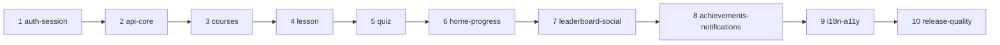

# CodeBro — 10-Branch Execution Plan

> Baseline: `6b61cfc` on `main` (NestJS API + Riverpod shell + consolidated UI).
> Status: **execution started**. Each branch is stacked on the previous one, committed separately, and verified before the next branch begins.

---

## Rules

1. Each branch owns a distinct set of files (listed below). A branch never edits another branch's owned files without declaring it.
2. Every branch ends with a commit; `main` stays untouched until all ten branches are reviewed.
3. Verification per branch: `dart format` clean on owned files, `dart analyze` clean on owned folders (modulo unresolved external packages until `flutter pub get`), `git diff --check`, no secrets, tests for behavior.
4. All user-facing strings go through `StringKeys` + catalogues; layouts stay RTL-safe; async surfaces use the shared loading/empty/error states.
5. Line budgets are targets for substantial work, not a promise of padding. No generated or duplicated filler.

---

## Branch chain

---

| # | Branch | Focus | Target lines | Owned files / folders |
|---|--------|-------|--------------|-----------------------|
| 1 | `feat/auth-session-hardening` | Refresh-token interceptor, token rotation, protected-route redirect, auth repository tests | 1,200 | `lib/core/network/*`, `lib/core/state/*`, `lib/features/authentication/data/*`, `test/features/auth/*` |
| 2 | `feat/api-core-pagination-cache` | Cursor pagination models, retry/backoff, TTL cache, typed error mapping | 1,000 | `lib/core/network/*`, `lib/core/data/*`, `test/core/network/*` |
| 3 | `feat/courses-catalog-connected` | Course list/detail from API, search + filters, skeleton/empty/error states | 1,400 | `lib/features/courses/**`, `test/features/courses/*` |
| 4 | `feat/lesson-player-connected` | Lesson content via API, Riverpod lesson controller, progress sync, code editor polish | 1,800 | `lib/features/lesson_interactive/**`, `test/features/lesson/*` |
| 5 | `feat/quiz-engine-connected` | Quiz fetch + attempt submit, scoring, XP award, result screen polish | 1,500 | `lib/features/quiz/**`, `lib/features/quiz/data/*`, `test/features/quiz/*` |
| 6 | `feat/home-progress-connected` | Dashboard stats, XP ledger, streak check-in, daily quests from API | 1,400 | `lib/features/home/**`, `lib/features/progress/**`, `test/features/home/*` |
| 7 | `feat/leaderboard-social-connected` | Live leaderboard tabs, friends, posts, likes, comments screens | 1,800 | `lib/features/leaderboard/**`, `lib/features/social/**`, `test/features/social/*` |
| 8 | `feat/achievements-notifications` | Badge grid from API, unlock evaluation, notification inbox | 1,300 | `lib/features/achievements/**`, `lib/features/notifications/**`, `test/features/achievements/*` |
| 9 | `feat/i18n-a11y-polish` | Catalogue parity for 6 locales, RTL sheets/drawers, semantics, reduced motion, golden tests | 1,600 | `lib/core/localization/**`, `lib/core/a11y/**`, `lib/features/rtl/**`, `test/golden/*` |
| 10 | `feat/release-quality` | CI matrix, dev/stg/prod flavors, release checklist, integration smoke tests | 1,200 | `.github/**`, `docs/release/**`, `test/integration/*`, `pubspec.yaml` |

**Total target: ≈ 15,200 lines.**

---

## Acceptance criteria

- **1–2:** token refresh works without user action; paginated lists never load all rows at once; cache invalidates on mutation; unit tests cover token rotation, retry, pagination cursors and cache TTL.
- **3–5:** catalog, lesson and quiz screens render real API data with graceful offline fallback; every async state has UI; tests cover filtering, lesson progression and quiz scoring.
- **6–8:** home stats, leaderboard, badges, friends/feed and notifications reflect API state; XP/streak/badge mutations update the UI immediately; tests cover the mapped domain logic.
- **9:** every catalogue has identical keys; en + ar render correctly with mirrored layouts; interactive elements have semantic labels; reduced-motion respected; golden tests for core components.
- **10:** CI runs analyze + tests + builds for both repositories; three flavors build; release checklist and smoke test documented.

## Risks

- Stacked branches can drift from `main`; rebase before merge.
- API must be running for integration checks; widget tests mock repositories instead.
- Golden tests need font loading to be deterministic; use `google_fonts` test mode or bundled fonts before asserting pixels.
